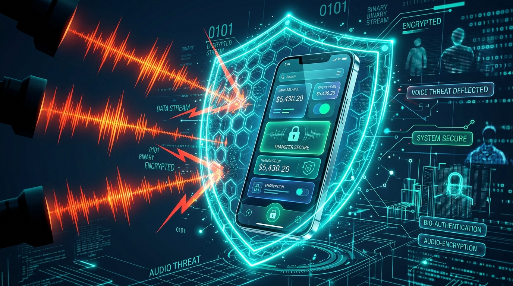
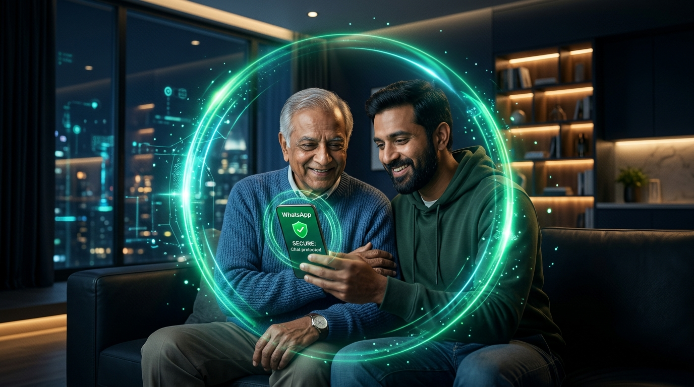
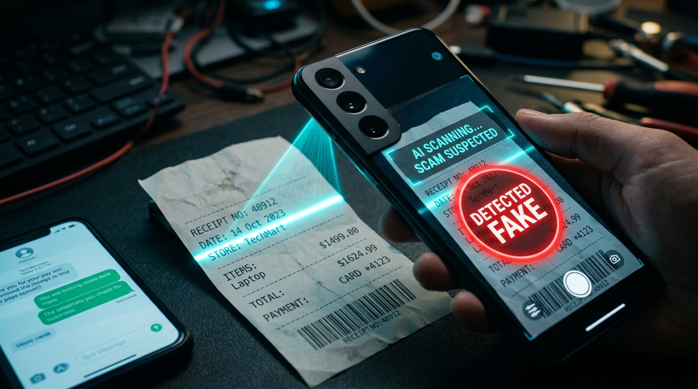
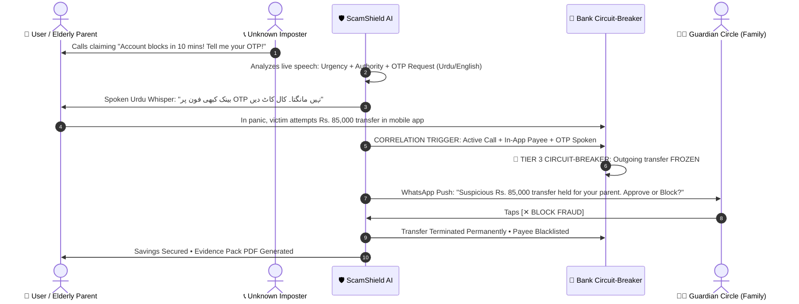

<div align="center">

# 🛡️ ScamShield Live
### *The Real-Time Guardian That Stops Voice Scams Before the Money Moves*

[](https://www.docker.com/)
[](https://react.dev/)
[](https://fastapi.tiangolo.com/)
[](https://ai.google.dev/)
[](https://www.pinecone.io/)
[](https://n8n.io/)

<br/>

**AI Builder Cup 2026 | Banking, Financial Services & Insurance (BFSI) Track**  
*Built for Individuals, Commercial Banks, Mobile Wallets (JazzCash / Easypaisa), Insurers, and Law Enforcement.*

<br/>



</div>

---

## ⚡ The Big Idea in Simple Words

Traditional banking fraud filters watch transactions **after** the victim has already been manipulated. In South Asia, the dominant cybercrime attack is social engineering over phone calls: an imposter pretending to be a bank officer, police inspector, or distressed family member pressures the victim into handing over an OTP or authorizing a transfer.

Because the victim authorizes the transaction themselves on their genuine device, **banks are blind to the attack**.

> **ScamShield Live turns the scam call itself into a fraud signal.**  
> It listens to the call in real time, understands **Urdu, Punjabi, Roman Urdu, and English**, detects psychological coercion, and engages a **Graduated Circuit-Breaker** that locks the money before it leaves the bank.

---

## 📸 System Showcase & Visual Walkthrough

<div align="center">
<table>
  <tr>
    <td width="50%">
      
      <p align="center"><b>🎙️ Hub 1: Voice-Clone Deepfake Shield</b><br/><i>Detects synthetic AI voices and triggers a secret family safe-word challenge.</i></p>
    </td>
    <td width="50%">
      
      <p align="center"><b>👥 Hub 2: Guardian Circle (WhatsApp)</b><br/><i>Loops trusted family members for 1-tap Approve or Block confirmation.</i></p>
    </td>
  </tr>
  <tr>
    <td colspan="2" align="center">
      
      <p align="center"><b>🔍 Hub 3: Scam Lens (Computer Vision)</b><br/><i>AI scanner analyzing fake SMS screenshots, doctored receipts, and malicious QR codes.</i></p>
    </td>
  </tr>
</table>
</div>

---

## 🛡️ How ScamShield Protects in 3 Simple Steps



---

## 🏛️ Organized Feature Architecture (The 3 Hubs)

### 🎙️ Hub 1: Real-Time Call & Voice Guardian
- **F1 • Live Call Guard**: Ephemeral audio streaming with sentence-by-sentence psychological threat scoring.
- **F2 • Multilingual Code-Switch Listener**: Comprehends rapid transitions between Urdu, Punjabi, Roman Urdu, and English.
- **F3 • Scam Playbook Classifier**: Identifies attack tactics (*Fake Bank Officer, Wallet Reversal, Lottery Prize, Police Fine*) and predicts the caller's next move.
- **F7 • Voice-Clone Shield**: Evaluates acoustic neural vocoder artefacts to flag cloned voices and prompts the secret **Family Safe-Word Challenge**.
- **F8 • Live Coach Whisper**: Calming, reassuring spoken alerts in Urdu Nastaliq script: *"بینک کبھی آپ سے فون پر OTP نہیں مانگتا۔ فوراً کال کاٹ دیں"*.

### 💳 Hub 2: Bank & Family Safety Net
- **F4 • Call-Transaction Correlation (NEW)**: Joins telecommunication signals with banking intent events into a single joint threat vector.
- **F5 • Transaction Circuit-Breaker (NEW)**:
  - **Tier 0 (0-29%)**: Safe • Silent monitoring.
  - **Tier 1 (30-59%)**: Caution • Soft warning banner on screen.
  - **Tier 2 (60-84%)**: Warning • Spoken Urdu alert + 60-second cool-off hold on transfers.
  - **Tier 3 (85-100%)**: Hard Block • Outgoing transfer locked before funds move.
- **F6 • Guardian Circle (NEW)**: Automated n8n workflow dispatching WhatsApp alerts to children or spouses with **1-tap [Approve]** or **[Block]** buttons.

### 🔍 Hub 3: Forensic Intelligence & Training
- **F9 • Scam Lens (Computer Vision)**: Multimodal inspection of fake SMS messages, altered JazzCash/Easypaisa payment slips, and QR code payloads.
- **F10/F11 • Scam Radar**: Clusters emerging call scripts into geographic campaigns using Pinecone vector representations.
- **F12 • Scam Gym**: Safe interactive sparring ring where users practice resisting an AI scammer at 3 difficulty levels.
- **F13 • Evidence Pack & Fast Claim**: One-click generation of cryptographic incident dossiers ready for Bank Disputes and the FIA Cybercrime department.
- **F14 • Privacy Vault**: Strict GDPR compliance: zero raw voice retention, on-device Voice Activity Detection (VAD), and automated credential redaction.

---

## 🐳 Multi-Container Docker Architecture

ScamShield Live is packaged into **4 independent microservices**:

```text
┌────────────────────────────────────────────────────────────────────────┐
│                        DOCKER BRIDGE NETWORK                           │
├─────────────────────┬─────────────────────┬────────────────────────────┤
│ scamshield-frontend │ scamshield-backend  │ scamshield-n8n  │  db-data │
│      (Port 5173)    │     (Port 8000)     │   (Port 5678)   │ (Pt 5432)│
│  React 19 + Nginx   │  FastAPI + WebSockets│  WhatsApp Flow  │ Postgres │
└─────────────────────┴─────────────────────┴────────────────────────────┘
```

| Service Container | Image / Base | Port | Description |
|---|---|---|---|
| `scamshield-frontend` | `nginx:alpine` | **5173 / 3000** | High-performance reverse-proxy serving the React 19 PWA. |
| `scamshield-backend` | `python:3.11-slim` | **8000** | FastAPI core engine with Gemini 2.5 scoring & Mock Bank API. |
| `scamshield-n8n` | `docker.n8n.io/n8nio/n8n` | **5678** | Guardian Circle WhatsApp approval automation engine. |
| `scamshield-db` | `postgres:16-alpine` | **5432** | Persistent database pre-seeded with bank accounts & guardians. |

---

## 🚀 Quickstart Guide (Run in 60 Seconds)

### Option 1: One-Command Docker Launch (Recommended)
With Docker Desktop running, launch the full stack from the project root:
```bash
docker compose up --build -d
```
The demo runs without API keys using its built-in fallback behavior. To enable Gemini or Pinecone, copy `.env.example` to `.env` and add your API keys before starting the stack.
Open your browser:
- 🌐 **Web PWA Dashboard**: [http://localhost:5173](http://localhost:5173) (or [http://localhost:3000](http://localhost:3000))
- ⚡ **Backend API & Swagger Docs**: [http://localhost:8000/docs](http://localhost:8000/docs)
- ⚙️ **n8n Automation Engine**: [http://localhost:5678](http://localhost:5678)

---

### Option 2: Local Development Mode

#### 1. Setup Backend:
```bash
python run_system.py
```

#### 2. Setup Frontend:
```bash
cd apps/web
npm install
npm run dev
```

---

## ⏱️ 3-Minute Hackathon Pitch Script (Section 12)

| Time | Scene | What the Audience / Judges See | Wow Factor |
|---|---|---|---|
| **0:00** | **Story Hook** | Story of an elderly parent nearly losing life savings to a "bank officer" phone call. | Emotional Anchor |
| **0:20** | **Genuine Call** | Select *Genuine Bank Customer Reminder*. Risk gauge stays green (Tier 0). | Low False Alarms |
| **0:45** | **Scam Call** | Select *Fake Bank Officer*. Risk climbs live. At the OTP ask, screen turns **Red**, Urdu voice warns, and outgoing transfer is **Hard Held**. | **Core Moment (F4 & F5)** |
| **1:30** | **Guardian Circle** | Switch to Guardian Circle tab. Son receives simulated WhatsApp alert with [Approve] / [Block]. Tapping Block locks the scammer out. | Live Interaction (F6) |
| **1:50** | **Voice-Clone Shield** | Select *Voice Clone (Relative in Trouble)*. Synthetic likelihood hits 95%, triggering the secret Family Safe-Word challenge. | Deepfake Threat (F7) |
| **2:10** | **Scam Lens** | Inspect fake SMS screenshot or tampered JazzCash receipt with instant OCR and tampering markers. | Computer Vision (F9) |
| **2:25** | **Scam Gym** | Switch to Scam Gym. Challenge a judge to spar against the AI scammer for 30 seconds. | Audience Participation (F12) |
| **2:40** | **Scam Radar** | Review live threat map across Pakistan & Pinecone semantic script clusters. Download the official Evidence Pack PDF. | B2B Scale (F10, F11, F13) |

---

## 📊 Benchmark Verification (Section 8)

Every metric is **measured** from a reproducible run, never hard-coded:
```bash
python ml/evaluation/run_evaluation.py          # or: python ml/notebooks/evaluation_metrics.py
pytest tests/ -q                                # unit tests for metrics, pipeline and fusion rules
```
Results are written to `reports/evaluation_report.md` / `.json` / `per_call_results.csv` and are also shown live in the
**Evaluation** tab of the web app (run the benchmark, speak-and-evaluate a sentence, record user-comprehension testers).

Covered: recall at fixed false-alarm rate, time-to-detect, false alarms per 100 genuine calls, intervention latency,
per-language fairness (Urdu, Roman Urdu, Punjabi, English, code-switched), scam-type / requested-action / per-tactic accuracy,
calibration, fusion design rules, prompt-injection robustness, Voice-Clone Shield and Scam Lens evaluation, and the
8-of-10 user-comprehension study. See [`ml/evaluation/README.md`](ml/evaluation/README.md) for the full mapping to the PDF.

> Without `GEMINI_API_KEY` the built-in keyword fallback is what gets evaluated, and the report says so. Add a key to `.env`
> and re-run to measure Gemini. The corpus is synthetic-plus-curated, so treat results as a regression baseline, not real-world accuracy.

---

## 📄 License & Team
Developed for **AI Builder Cup 2026** under the **Banking, Financial Services & Insurance (BFSI) Track**.  
Licensed under the MIT License.
